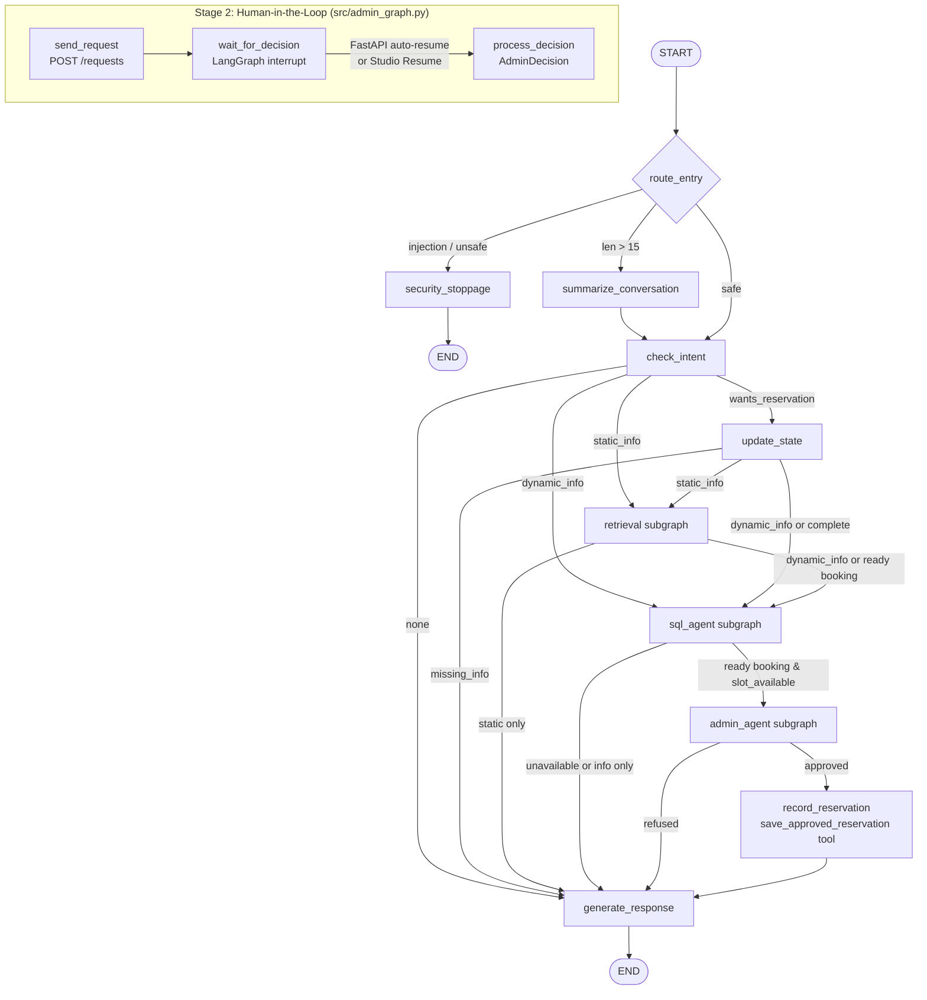
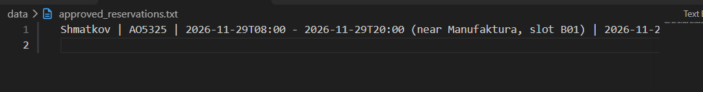

# Parking Space Reservation Chatbot — Stage 3 (Confirmed Reservation Recording)

An intelligent parking-space assistant built with **Python**, **LangChain**, **LangGraph**, and **FastAPI** as part of the *AI Solution Engineering: Fast Track Course (Module 9)*.

Stage 3 completes the reservation persistence pipeline: once the Human-in-the-Loop administrator approves a request, the workflow invokes a dedicated **LangChain tool/function (`save_approved_reservation`)** inside a `record_reservation` node to safely persist the confirmed booking to `data/approved_reservations.txt` before confirming to the user. *(Implements the specification's tool/function-call recording option.)*

---

## Key Features

### Stage 3 — Confirmed Reservation Recording (`src/reservation_recorder.py`)
- **LangChain Recording Tool (`save_approved_reservation`):** Triggered exclusively after `admin_agent` returns `status == "approved"` via the `route_after_admin` conditional edge and `record_reservation` node in [graph/graph.py](graph/graph.py).
- **Required File Entry Format:** Appends each confirmed reservation to `data/approved_reservations.txt` as:
  ```text
  Name | Car Number | Reservation Period | Approval Time
  ```
  Example recorded entry from a live run ([data/approved_reservations.txt](data/approved_reservations.txt)):
  ```text
  Shmatkov | AO5325 | 2026-11-29T08:00 - 2026-11-29T20:00 (near Manufaktura, slot B01) | 2026-11-21T00:00:05.047342+00:00
  ```
- **Security & Reliability Controls:**
  - **Fixed storage target:** Writes strictly to `data/approved_reservations.txt` (never accepts a caller-supplied path, preventing path traversal).
  - **Approval gate:** Both `route_after_admin` and `record_reservation` enforce `admin_decision.status == "approved"` — refused or unapproved bookings are never written.
  - **Field sanitization:** `_clean_field` strips newlines (`\r`, `\n`) and replaces `|` with `/` to prevent forged records or delimiter injection, and rejects empty fields.
  - **Thread-safe durable writes:** Protected by a `threading.Lock` with `flush()` + `os.fsync()`.
  - **Failure transparency:** Returns structured `{ok, entry, file_path}` or `{ok: False, error}`. If persistence fails, `generate_response` informs the user that confirmation is incomplete and requires administrator follow-up.

### Stage 2 — Human-in-the-Loop Administrator Agent (Included)
- **Second LangChain Agent (`src/admin_graph.py`):** 3-node subgraph (`send_request` → `wait_for_decision` via LangGraph `interrupt()` → `process_decision` via structured output `AdminDecision`).
- **FastAPI Administrator REST API (`src/admin_api.py`):** `POST /requests`, `GET /requests`, `GET /requests/{request_id}`, and `POST /requests/{request_id}/decision` (with `409 Conflict` duplicate protection and automatic LangGraph Server thread resume).

### Stage 1 — RAG Chatbot, Guardrails & Evaluation (Included)
- **Static + Dynamic Data Split:** ChromaDB + BM25 hybrid retrieval (`0.60` / `0.40`) over 14 policy/location PDFs; read-only SQLite ReAct agent (`data/parking.db`) for November 2026 availability, hours, and hourly prices.
- **Multi-Layer Guardrails:** Prompt-injection regex + LLM classifier (`InputSanitizer`, `SecutiryGuard`), read-only SQL authorizer (`MAX_SQL_CALLS = 3`), and local NLP PII redaction via **Microsoft Presidio + spaCy `en_core_web_sm`** on both vector DB documents and SQL rows.
- **RAG Evaluation & CI:** Automated `Recall@K`, `Precision@K`, `MRR`, and latency reporting ([eval/report.md](eval/report.md)) plus 39 `pytest` unit tests running on GitHub Actions.

---

## Architecture



---

## Screenshots (Live Demo)

### 1. LangGraph Studio — Approval Flow & User Confirmation


### 2. FastAPI Admin REST API (`/docs`) — Decision & Duplicate Protection


---

## Project Structure

```text
parking_project/
├── .github/workflows/
│   └── tests.yml                    # GitHub Actions CI (uv sync --locked + pytest)
├── data/
│   ├── approved_reservations.txt    # Stage 3: Confirmed reservations storage file
│   ├── chroma_db/                   # Persisted Chroma vector database (static PDFs)
│   └── parking.db                   # SQLite database (dynamic slots, prices, hours)
├── docs/
│   ├── image.png                    # FastAPI Admin API decision screenshot
│   └── langsmith.png                # LangGraph Studio approval flow screenshot
├── eval/
│   ├── dataset.json                 # 12 ground-truth RAG evaluation queries
│   ├── evaluate_rag.py              # Recall@K, Precision@K, MRR, latency evaluator
│   └── report.md                    # Generated RAG evaluation report
├── graph/
│   └── graph.py                     # Main LangGraph workflow (RAG + SQL + Admin + Recorder)
├── seed_ingest/
│   ├── pdfs/                        # 14 fictional parking policy & location PDFs
│   ├── dynamic_data.py              # Generates data/parking.db (360 November 2026 slots)
│   └── static_data.py               # Ingests PDFs into data/chroma_db
├── src/
│   ├── admin_api.py                 # Stage 2: FastAPI REST API + LangGraph auto-resume
│   ├── admin_graph.py               # Stage 2: Human-in-the-Loop admin approval subgraph
│   ├── functions.py                 # Retrievers, helpers, Presidio/spaCy PII redaction
│   ├── guardrails.py                # InputSanitizer and safe_sql validation
│   ├── models_vector.py             # OpenAI LLM/embedding & Chroma initialization
│   ├── prompts.py                   # Prompts for routing, RAG, SQL, admin, final response
│   ├── react_graph.py               # Read-only SQL ReAct subgraph + availability check
│   ├── reservation_recorder.py      # Stage 3: Secure save_approved_reservation LangChain tool
│   ├── retrieval_graph.py           # Hybrid RAG + grading/rewrite subgraph
│   ├── schema.py                    # Pydantic state, SQL availability & AdminDecision schemas
│   └── security.py                  # LLM-based SecutiryGuard classifier
├── tests/
│   ├── test_admin_api.py            # FastAPI Admin API & auto-resume unit tests
│   ├── test_admin_graph.py          # Admin subgraph interrupt(), idempotency & decision tests
│   ├── test_eval.py                 # RAG evaluation metrics & report unit tests
│   ├── test_guards.py               # Prompt-injection detection & sanitization tests
│   └── test_pii.py                  # Presidio + spaCy PII redaction & SQL row tests
├── langgraph.json                   # LangGraph Server / Studio configuration
├── pyproject.toml                   # Dependencies & pytest config (managed by uv)
└── uv.lock                          # Cross-platform lockfile
```

---

## Setup

### Prerequisites
- Python **3.12**
- [uv](https://docs.astral.sh/uv/) package manager
- OpenAI API key (`OPENAI_API_KEY`)

### 1. Clone & Install Dependencies
```bash
git clone <your-repo-url>
cd parking_project
uv sync --locked
```

### 2. Configure Environment Variables
Create a `.env` file in the project root:
```env
OPENAI_API_KEY=your_openai_api_key

# Optional overrides (defaults shown)
ADMIN_API_URL=http://127.0.0.1:8000
LANGGRAPH_API_URL=http://127.0.0.1:2024
LANGGRAPH_ASSISTANT_ID=graph
```

### 3. (Optional) Regenerate Data Fixtures
Pre-seeded `data/parking.db` and `data/chroma_db/` are included. To rebuild them from scratch:
```bash
uv run python -m seed_ingest.dynamic_data
uv run python -m seed_ingest.static_data
```

---

## Usage (Running Stages 1–3 End-to-End)

Start both local servers in separate terminals:

```bash
# Terminal 1 — FastAPI Admin REST API (Swagger UI at http://127.0.0.1:8000/docs)
uv run uvicorn src.admin_api:app --port 8000

# Terminal 2 — LangGraph Dev Server / Studio (port 2024)
uv pip install "langgraph-cli[inmem]"
uv run langgraph dev
```

### End-to-End Flow
1. **User submits a reservation** in LangGraph Studio (name, car plate, venue, date, arrival & departure time).
2. **`sql_agent` verifies availability** in `data/parking.db` and selects an available slot (e.g. `B01`).
3. **`admin_agent` escalates the request** (`POST /requests`) to FastAPI and pauses via `interrupt()`.
4. **Administrator approves or refuses** via Swagger (`http://127.0.0.1:8000/docs`) or HTTP:
   ```bash
   curl -X POST http://127.0.0.1:8000/requests/<REQUEST_ID>/decision \
     -H "Content-Type: application/json" \
     -d '{"decision": "approved", "comment": "Approved"}'
   ```
5. **Auto-resume & persistence:** FastAPI automatically resumes the paused LangGraph thread. On approval, `record_reservation` invokes `save_approved_reservation`, appends the entry to `data/approved_reservations.txt`, and `generate_response` confirms the saved booking to the user.

---

## RAG Evaluation (Stage 1 Baseline)

Re-run retrieval evaluation against [eval/dataset.json](eval/dataset.json):
```bash
uv run python -m eval.evaluate_rag
```

Latest measured metrics ([eval/report.md](eval/report.md)):

| Metric | @1 | @4 |
| --- | ---: | ---: |
| **Recall** | 0.875 | 1.000 |
| **Precision** | 1.000 | 0.312 |
| **MRR** | 1.000 | 1.000 |

| Avg Latency | p50 Latency | p95 Latency | Max Latency |
| ---: | ---: | ---: | ---: |
| 426.2 ms | 199.9 ms | 1339.6 ms | 2247.3 ms |

---

## Testing & CI/CD

Run the automated test suite (runs offline with no API key required):
```bash
uv run pytest tests/ -v
```

GitHub Actions ([.github/workflows/tests.yml](.github/workflows/tests.yml)) automatically runs `uv sync --locked` and `uv run python -m pytest tests/ -v` on every push and pull request (**39 tests** across guardrails, PII redaction, RAG evaluation, FastAPI Admin API, and the HITL admin subgraph).

---

## Roadmap

- **Stage 4:** End-to-end integration tests, load testing across chatbot/admin/recording components, and complete system documentation.
